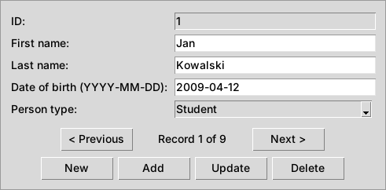

# School Database System (SQL Server + Python GUI)

A relational database system designed to manage school data: students, teachers, classes, timetables, lessons, attendance, grades and homework. The project includes 16 related tables, views and functions for reporting, stored procedures and triggers that keep the data consistent, an automatic change history, and a backup and restore strategy. A simple Python GUI (Tkinter) is used to manage the `People` table.

**Stack:** SQL Server 2017+ (T-SQL), Python 3.10+, Tkinter, pyodbc.

The code below is the same as in the `.sql` and `.py` files of this repository. See [README.md](README.md) for a short overview and instructions on how to run the project.

## Key Features
- **16 related tables** with primary and foreign keys, CHECK / UNIQUE / NOT NULL constraints and indexes
- **Inheritance (Table-per-Type):** `People` (supertype) with `Students` and `Teachers` (subtypes); a composite foreign key makes sure that each person has the correct role
- **9 views** for reports and **3 functions** for calculations (average grade, number of absences, highest grade)
- **6 stored procedures** for everyday operations (including adding a student in one transaction)
- **7 triggers** for validation, conflict detection, change history, lesson cancellation and clean-up of related data
- **Change history:** every change of a grade or a timetable slot is saved automatically in `GradeHistory` / `ScheduleHistory`
- **Backup strategy:** full and differential backups, verification and restore
- **Tests:** a script with 11 checks of the business rules
- **Python GUI (Tkinter)** for CRUD operations on the `People` table

## System Features
- **Student management** – adding, modifying and deleting students (together with their related data).
- **Grade tracking** – recording and updating grades and teacher comments, with a full history of changes.
- **Lesson scheduling** – weekly timetables and individual lessons; double bookings of a class or a teacher are rejected.
- **Homework management** – assigning homework, recording submissions and marking them.
- **Attendance monitoring** – recording attendance (present, absent, late); attendance of cancelled lessons is updated automatically.
- **Consultations and events** – organizing teacher consultations and school events.
- **Data security** – backup and recovery procedures in case of failure.

## Tables
| Table | Description |
|---|---|
| `People` | Everyone in the school: name, date of birth, type (`Student` / `Teacher`) |
| `Students` | Students: class and enrolment date (subtype of `People`) |
| `Teachers` | Teachers: subject and hire date (subtype of `People`) |
| `Subjects` | School subjects |
| `Classes` | Classes and their homeroom teachers |
| `Schedules` | Weekly timetable: class, subject, teacher, day of week, start time |
| `ScheduleHistory` | Log of changes in the timetable (filled by a trigger) |
| `Lessons` | Individual lessons with date, time and cancellation flag |
| `Attendance` | Attendance of students in lessons |
| `Grades` | Grades on the 1–6 scale |
| `GradeHistory` | Log of grade changes (filled by a trigger) |
| `GradeComments` | Teachers' comments on grades |
| `Homework` | Homework assigned to classes |
| `SubmittedHomework` | Homework submitted by students, with marks |
| `TeacherConsultations` | Teachers' consultation hours |
| `SchoolEvents` | School events and their organisers |

## SQL Code

### Creating the database
```sql
/* =====================================================================
   00_create_database.sql
   Creates the SchoolDB database. Run this script first.
   ===================================================================== */

IF DB_ID(N'SchoolDB') IS NULL
    CREATE DATABASE SchoolDB;
GO
```

### Creating tables (with constraints and indexes)
```sql
/* =====================================================================
   01_tables.sql
   Creates 16 tables with primary keys, foreign keys, CHECK / UNIQUE
   constraints and indexes on the columns used in joins and filters.
   ===================================================================== */

USE SchoolDB;
GO
-- Required for the persisted computed columns used in foreign keys
SET ANSI_NULLS ON;
SET QUOTED_IDENTIFIER ON;
GO

/* ---------------------------------------------------------------------
   People: supertype table for students and teachers
   (Table-per-Type inheritance: People -> Students / Teachers).
   The UNIQUE (PersonID, PersonType) constraint lets the subtype tables
   check that a person is of the right type (see Students and Teachers).
   --------------------------------------------------------------------- */
CREATE TABLE People (
    PersonID     INT IDENTITY(1,1) CONSTRAINT PK_People PRIMARY KEY,
    FirstName    NVARCHAR(50) NOT NULL,
    LastName     NVARCHAR(50) NOT NULL,
    DateOfBirth  DATE         NOT NULL,
    PersonType   NVARCHAR(10) NOT NULL
        CONSTRAINT CK_People_PersonType CHECK (PersonType IN (N'Student', N'Teacher')),
    CONSTRAINT UQ_People_PersonID_PersonType UNIQUE (PersonID, PersonType)
);
CREATE INDEX IX_People_LastName ON People (LastName);

CREATE TABLE Subjects (
    SubjectID    INT IDENTITY(1,1) CONSTRAINT PK_Subjects PRIMARY KEY,
    SubjectName  NVARCHAR(100) NOT NULL CONSTRAINT UQ_Subjects_SubjectName UNIQUE
);

-- Only a person with PersonType = 'Teacher' can be added here
CREATE TABLE Teachers (
    TeacherID   INT CONSTRAINT PK_Teachers PRIMARY KEY,
    PersonType  AS CAST(N'Teacher' AS NVARCHAR(10)) PERSISTED,
    SubjectID   INT  NOT NULL,
    HireDate    DATE NOT NULL,
    CONSTRAINT FK_Teachers_People   FOREIGN KEY (TeacherID, PersonType) REFERENCES People (PersonID, PersonType),
    CONSTRAINT FK_Teachers_Subjects FOREIGN KEY (SubjectID) REFERENCES Subjects (SubjectID)
);
CREATE INDEX IX_Teachers_SubjectID ON Teachers (SubjectID);

CREATE TABLE Classes (
    ClassID            INT IDENTITY(1,1) CONSTRAINT PK_Classes PRIMARY KEY,
    ClassName          NVARCHAR(20) NOT NULL CONSTRAINT UQ_Classes_ClassName UNIQUE,
    HomeroomTeacherID  INT NULL,
    CONSTRAINT FK_Classes_Teachers FOREIGN KEY (HomeroomTeacherID) REFERENCES Teachers (TeacherID)
);

-- Only a person with PersonType = 'Student' can be added here
CREATE TABLE Students (
    StudentID       INT CONSTRAINT PK_Students PRIMARY KEY,
    PersonType      AS CAST(N'Student' AS NVARCHAR(10)) PERSISTED,
    ClassID         INT  NOT NULL,
    EnrollmentDate  DATE NOT NULL,
    CONSTRAINT FK_Students_People  FOREIGN KEY (StudentID, PersonType) REFERENCES People (PersonID, PersonType),
    CONSTRAINT FK_Students_Classes FOREIGN KEY (ClassID) REFERENCES Classes (ClassID)
);
CREATE INDEX IX_Students_ClassID ON Students (ClassID);

-- Individual lessons. A cancelled lesson is kept and marked with IsCancelled = 1.
CREATE TABLE Lessons (
    LessonID        INT IDENTITY(1,1) CONSTRAINT PK_Lessons PRIMARY KEY,
    ClassID         INT          NOT NULL,
    SubjectID       INT          NOT NULL,
    TeacherID       INT          NOT NULL,
    LessonDateTime  DATETIME2(0) NOT NULL,
    IsCancelled     BIT          NOT NULL CONSTRAINT DF_Lessons_IsCancelled DEFAULT (0),
    CONSTRAINT FK_Lessons_Classes  FOREIGN KEY (ClassID)   REFERENCES Classes (ClassID),
    CONSTRAINT FK_Lessons_Subjects FOREIGN KEY (SubjectID) REFERENCES Subjects (SubjectID),
    CONSTRAINT FK_Lessons_Teachers FOREIGN KEY (TeacherID) REFERENCES Teachers (TeacherID)
);
CREATE INDEX IX_Lessons_ClassID_LessonDateTime   ON Lessons (ClassID, LessonDateTime);
CREATE INDEX IX_Lessons_TeacherID_LessonDateTime ON Lessons (TeacherID, LessonDateTime);

-- Grades on the Polish school scale 1-6 (half grades allowed, e.g. 4.5)
CREATE TABLE Grades (
    GradeID     INT IDENTITY(1,1) CONSTRAINT PK_Grades PRIMARY KEY,
    StudentID   INT          NOT NULL,
    SubjectID   INT          NOT NULL,
    GradeValue  DECIMAL(3,1) NOT NULL,
    GradeDate   DATE         NOT NULL CONSTRAINT DF_Grades_GradeDate DEFAULT (CAST(GETDATE() AS DATE)),
    CONSTRAINT FK_Grades_Students FOREIGN KEY (StudentID) REFERENCES Students (StudentID),
    CONSTRAINT FK_Grades_Subjects FOREIGN KEY (SubjectID) REFERENCES Subjects (SubjectID)
);
CREATE INDEX IX_Grades_StudentID ON Grades (StudentID);
CREATE INDEX IX_Grades_SubjectID ON Grades (SubjectID);

-- Weekly timetable (1 = Monday ... 5 = Friday)
CREATE TABLE Schedules (
    ScheduleID  INT IDENTITY(1,1) CONSTRAINT PK_Schedules PRIMARY KEY,
    ClassID     INT     NOT NULL,
    SubjectID   INT     NOT NULL,
    TeacherID   INT     NOT NULL,
    DayOfWeek   TINYINT NOT NULL CONSTRAINT CK_Schedules_DayOfWeek CHECK (DayOfWeek BETWEEN 1 AND 5),
    StartTime   TIME(0) NOT NULL,
    CONSTRAINT FK_Schedules_Classes  FOREIGN KEY (ClassID)   REFERENCES Classes (ClassID),
    CONSTRAINT FK_Schedules_Subjects FOREIGN KEY (SubjectID) REFERENCES Subjects (SubjectID),
    CONSTRAINT FK_Schedules_Teachers FOREIGN KEY (TeacherID) REFERENCES Teachers (TeacherID),
    CONSTRAINT UQ_Schedules_Class_Slot UNIQUE (ClassID, DayOfWeek, StartTime)
);

-- Audit table: filled automatically by the LogGradeChanges trigger
CREATE TABLE GradeHistory (
    HistoryID      INT IDENTITY(1,1) CONSTRAINT PK_GradeHistory PRIMARY KEY,
    GradeID        INT          NOT NULL,
    OldGradeValue  DECIMAL(3,1) NOT NULL,
    NewGradeValue  DECIMAL(3,1) NOT NULL,
    ChangedAt      DATETIME2(0) NOT NULL CONSTRAINT DF_GradeHistory_ChangedAt DEFAULT (SYSDATETIME()),
    CONSTRAINT FK_GradeHistory_Grades FOREIGN KEY (GradeID) REFERENCES Grades (GradeID)
);
CREATE INDEX IX_GradeHistory_GradeID ON GradeHistory (GradeID);

-- Audit table: filled automatically by the LogScheduleChanges trigger
CREATE TABLE ScheduleHistory (
    HistoryID     INT IDENTITY(1,1) CONSTRAINT PK_ScheduleHistory PRIMARY KEY,
    ScheduleID    INT          NOT NULL,
    OldDayOfWeek  TINYINT      NOT NULL,
    NewDayOfWeek  TINYINT      NOT NULL,
    OldStartTime  TIME(0)      NOT NULL,
    NewStartTime  TIME(0)      NOT NULL,
    ChangedAt     DATETIME2(0) NOT NULL CONSTRAINT DF_ScheduleHistory_ChangedAt DEFAULT (SYSDATETIME()),
    CONSTRAINT FK_ScheduleHistory_Schedules FOREIGN KEY (ScheduleID) REFERENCES Schedules (ScheduleID)
);
CREATE INDEX IX_ScheduleHistory_ScheduleID ON ScheduleHistory (ScheduleID);

-- One attendance record per student per lesson
CREATE TABLE Attendance (
    AttendanceID  INT IDENTITY(1,1) CONSTRAINT PK_Attendance PRIMARY KEY,
    StudentID     INT          NOT NULL,
    LessonID      INT          NOT NULL,
    Status        NVARCHAR(20) NOT NULL
        CONSTRAINT CK_Attendance_Status CHECK (Status IN (N'Present', N'Absent', N'Late', N'Cancelled')),
    CONSTRAINT FK_Attendance_Students FOREIGN KEY (StudentID) REFERENCES Students (StudentID),
    CONSTRAINT FK_Attendance_Lessons  FOREIGN KEY (LessonID)  REFERENCES Lessons (LessonID),
    CONSTRAINT UQ_Attendance_Student_Lesson UNIQUE (StudentID, LessonID)
);
CREATE INDEX IX_Attendance_LessonID ON Attendance (LessonID);

CREATE TABLE Homework (
    HomeworkID   INT IDENTITY(1,1) CONSTRAINT PK_Homework PRIMARY KEY,
    ClassID      INT           NOT NULL,
    SubjectID    INT           NOT NULL,
    Description  NVARCHAR(255) NOT NULL,
    DueDate      DATE          NOT NULL,
    CONSTRAINT FK_Homework_Classes  FOREIGN KEY (ClassID)   REFERENCES Classes (ClassID),
    CONSTRAINT FK_Homework_Subjects FOREIGN KEY (SubjectID) REFERENCES Subjects (SubjectID)
);
CREATE INDEX IX_Homework_ClassID ON Homework (ClassID);

-- One submission per student per homework; the grade is NULL until it is marked
CREATE TABLE SubmittedHomework (
    SubmissionID    INT IDENTITY(1,1) CONSTRAINT PK_SubmittedHomework PRIMARY KEY,
    HomeworkID      INT          NOT NULL,
    StudentID       INT          NOT NULL,
    SubmissionDate  DATE         NOT NULL,
    GradeValue      DECIMAL(3,1) NULL
        CONSTRAINT CK_SubmittedHomework_GradeValue CHECK (GradeValue BETWEEN 1 AND 6),
    CONSTRAINT FK_SubmittedHomework_Homework FOREIGN KEY (HomeworkID) REFERENCES Homework (HomeworkID),
    CONSTRAINT FK_SubmittedHomework_Students FOREIGN KEY (StudentID)  REFERENCES Students (StudentID),
    CONSTRAINT UQ_SubmittedHomework_Homework_Student UNIQUE (HomeworkID, StudentID)
);
CREATE INDEX IX_SubmittedHomework_StudentID ON SubmittedHomework (StudentID);

CREATE TABLE GradeComments (
    CommentID    INT IDENTITY(1,1) CONSTRAINT PK_GradeComments PRIMARY KEY,
    GradeID      INT           NOT NULL,
    TeacherID    INT           NOT NULL,
    CommentText  NVARCHAR(255) NOT NULL,
    CONSTRAINT FK_GradeComments_Grades   FOREIGN KEY (GradeID)   REFERENCES Grades (GradeID),
    CONSTRAINT FK_GradeComments_Teachers FOREIGN KEY (TeacherID) REFERENCES Teachers (TeacherID)
);
CREATE INDEX IX_GradeComments_GradeID ON GradeComments (GradeID);

CREATE TABLE TeacherConsultations (
    ConsultationID        INT IDENTITY(1,1) CONSTRAINT PK_TeacherConsultations PRIMARY KEY,
    TeacherID             INT           NOT NULL,
    ConsultationDateTime  DATETIME2(0)  NOT NULL,
    Notes                 NVARCHAR(255) NULL,
    CONSTRAINT FK_TeacherConsultations_Teachers FOREIGN KEY (TeacherID) REFERENCES Teachers (TeacherID)
);

CREATE TABLE SchoolEvents (
    EventID      INT IDENTITY(1,1) CONSTRAINT PK_SchoolEvents PRIMARY KEY,
    EventName    NVARCHAR(100) NOT NULL,
    EventDate    DATE          NOT NULL,
    Description  NVARCHAR(255) NULL,
    OrganizerID  INT           NULL,
    CONSTRAINT FK_SchoolEvents_Teachers FOREIGN KEY (OrganizerID) REFERENCES Teachers (TeacherID)
);
GO
```

### Inserting sample data
```sql
/* =====================================================================
   02_sample_data.sql
   Inserts sample data. Run it on a freshly created database:
   IDENTITY values are generated in insert order (1, 2, 3, ...).
   ===================================================================== */

USE SchoolDB;
GO
-- Required for the persisted computed columns used in foreign keys
SET ANSI_NULLS ON;
SET QUOTED_IDENTIFIER ON;
GO

INSERT INTO People (FirstName, LastName, DateOfBirth, PersonType)
VALUES (N'Jan',        N'Kowalski',    '2009-04-12', N'Student'),  -- 1
       (N'Anna',       N'Nowak',       '1990-09-25', N'Teacher'),  -- 2
       (N'Piotr',      N'Wiśniewski',  '1982-03-14', N'Teacher'),  -- 3
       (N'Katarzyna',  N'Wójcik',      '1988-11-02', N'Teacher'),  -- 4
       (N'Zofia',      N'Lewandowska', '2009-07-21', N'Student'),  -- 5
       (N'Michał',     N'Zieliński',   '2009-01-30', N'Student'),  -- 6
       (N'Aleksandra', N'Kamińska',    '2008-10-05', N'Student'),  -- 7
       (N'Tomasz',     N'Szymański',   '2008-06-17', N'Student'),  -- 8
       (N'Natalia',    N'Dąbrowska',   '2008-12-09', N'Student');  -- 9

INSERT INTO Subjects (SubjectName)
VALUES (N'Mathematics'),  -- 1
       (N'Physics'),      -- 2
       (N'English');      -- 3

INSERT INTO Teachers (TeacherID, SubjectID, HireDate)
VALUES (2, 1, '2015-08-20'),
       (3, 2, '2012-09-01'),
       (4, 3, '2018-09-01');

INSERT INTO Classes (ClassName, HomeroomTeacherID)
VALUES (N'1A', 2),  -- 1
       (N'2A', 3);  -- 2

INSERT INTO Students (StudentID, ClassID, EnrollmentDate)
VALUES (1, 1, '2024-09-01'),
       (5, 1, '2024-09-01'),
       (6, 1, '2024-09-01'),
       (7, 2, '2023-09-01'),
       (8, 2, '2023-09-01'),
       (9, 2, '2023-09-01');

-- Weekly timetable
INSERT INTO Schedules (ClassID, SubjectID, TeacherID, DayOfWeek, StartTime)
VALUES (1, 1, 2, 1, '08:00'),  -- 1A, Monday,  Mathematics
       (1, 2, 3, 1, '08:55'),  -- 1A, Monday,  Physics
       (1, 3, 4, 2, '08:00'),  -- 1A, Tuesday, English
       (2, 2, 3, 1, '08:00'),  -- 2A, Monday,  Physics
       (2, 1, 2, 1, '08:55'),  -- 2A, Monday,  Mathematics
       (2, 3, 4, 2, '08:55');  -- 2A, Tuesday, English

-- Lessons held in the week of 17 February 2025
INSERT INTO Lessons (ClassID, SubjectID, TeacherID, LessonDateTime)
VALUES (1, 1, 2, '2025-02-17 08:00'),  -- 1
       (1, 2, 3, '2025-02-17 08:55'),  -- 2
       (2, 2, 3, '2025-02-17 08:00'),  -- 3
       (2, 1, 2, '2025-02-17 08:55'),  -- 4
       (1, 3, 4, '2025-02-18 08:00'),  -- 5
       (2, 3, 4, '2025-02-18 08:55');  -- 6

INSERT INTO Attendance (StudentID, LessonID, Status)
VALUES (1, 1, N'Present'), (5, 1, N'Present'), (6, 1, N'Absent'),
       (1, 2, N'Present'), (5, 2, N'Late'),    (6, 2, N'Absent'),
       (1, 5, N'Present'), (5, 5, N'Present'), (6, 5, N'Present'),
       (7, 3, N'Present'), (8, 3, N'Absent'),  (9, 3, N'Present'),
       (7, 4, N'Present'), (8, 4, N'Present'), (9, 4, N'Late'),
       (7, 6, N'Present'), (8, 6, N'Absent'),  (9, 6, N'Present');

INSERT INTO Grades (StudentID, SubjectID, GradeValue, GradeDate)
VALUES (1, 1, 5.0, '2025-02-18'), (1, 2, 4.0, '2025-02-20'), (1, 3, 4.5, '2025-02-21'),
       (5, 1, 3.5, '2025-02-18'), (5, 2, 4.5, '2025-02-20'), (5, 3, 5.0, '2025-02-21'),
       (6, 1, 2.0, '2025-02-18'), (6, 2, 3.0, '2025-02-20'), (6, 3, 4.0, '2025-02-21'),
       (7, 1, 6.0, '2025-02-18'), (7, 2, 5.0, '2025-02-20'), (7, 3, 5.5, '2025-02-21'),
       (8, 1, 3.0, '2025-02-18'), (8, 2, 2.5, '2025-02-20'), (8, 3, 4.0, '2025-02-21'),
       (9, 1, 4.5, '2025-02-18'), (9, 2, 5.0, '2025-02-20'), (9, 3, 3.5, '2025-02-21');

INSERT INTO Homework (ClassID, SubjectID, Description, DueDate)
VALUES (1, 1, N'Solve quadratic equations (exercises 1-10)', '2025-02-25'),  -- 1
       (1, 2, N'Lab report: free fall experiment',            '2025-02-27'),  -- 2
       (2, 3, N'Essay: my favourite book',                    '2025-02-28');  -- 3

INSERT INTO SubmittedHomework (HomeworkID, StudentID, SubmissionDate, GradeValue)
VALUES (1, 1, '2025-02-24', 4.5),
       (1, 5, '2025-02-25', 5.0),
       (2, 1, '2025-02-26', NULL),  -- submitted, not marked yet
       (3, 7, '2025-02-27', 6.0),
       (3, 9, '2025-02-28', 4.0);

INSERT INTO GradeComments (GradeID, TeacherID, CommentText)
VALUES (1,  2, N'Good work, but pay more attention to details.'),
       (7,  2, N'Please review the chapter on linear functions.'),
       (14, 3, N'Needs more practice with kinematics problems.');

INSERT INTO TeacherConsultations (TeacherID, ConsultationDateTime, Notes)
VALUES (2, '2025-03-01 14:00', N'Discussion of semester projects.'),
       (4, '2025-03-03 15:00', N'Preparation for the English exam.');

INSERT INTO SchoolEvents (EventName, EventDate, Description, OrganizerID)
VALUES (N'School Open Day', '2025-04-15', N'Presentation of the school for future students.', 2),
       (N'Science Fair',    '2025-05-20', N'Student projects in physics and mathematics.',    3);
GO
```

### Creating views
```sql
/* =====================================================================
   03_views.sql
   9 views that join the tables into readable reports.
   ===================================================================== */

USE SchoolDB;
GO
-- Required for the persisted computed columns used in foreign keys
SET ANSI_NULLS ON;
SET QUOTED_IDENTIFIER ON;
GO

-- Students with their personal data and class
CREATE OR ALTER VIEW dbo.vw_Students AS
SELECT s.StudentID,
       p.FirstName,
       p.LastName,
       p.DateOfBirth,
       c.ClassName,
       s.EnrollmentDate
FROM dbo.Students s
JOIN dbo.People   p ON p.PersonID = s.StudentID
JOIN dbo.Classes  c ON c.ClassID  = s.ClassID;
GO

-- Teachers with the subject they teach and their hire date
CREATE OR ALTER VIEW dbo.vw_Teachers AS
SELECT t.TeacherID,
       p.FirstName,
       p.LastName,
       sub.SubjectName,
       t.HireDate
FROM dbo.Teachers t
JOIN dbo.People   p   ON p.PersonID    = t.TeacherID
JOIN dbo.Subjects sub ON sub.SubjectID = t.SubjectID;
GO

-- All grades with student, class and subject
CREATE OR ALTER VIEW dbo.vw_Grades AS
SELECT g.GradeID,
       g.StudentID,
       p.FirstName,
       p.LastName,
       c.ClassName,
       sub.SubjectName,
       g.GradeValue,
       g.GradeDate
FROM dbo.Grades   g
JOIN dbo.Students s   ON s.StudentID   = g.StudentID
JOIN dbo.People   p   ON p.PersonID    = s.StudentID
JOIN dbo.Classes  c   ON c.ClassID     = s.ClassID
JOIN dbo.Subjects sub ON sub.SubjectID = g.SubjectID;
GO

-- Lessons with class, subject, teacher's full name and status
CREATE OR ALTER VIEW dbo.vw_Lessons AS
SELECT l.LessonID,
       c.ClassName,
       sub.SubjectName,
       p.FirstName + N' ' + p.LastName AS TeacherName,
       l.LessonDateTime,
       CASE WHEN l.IsCancelled = 1 THEN N'Cancelled' ELSE N'Scheduled' END AS LessonStatus
FROM dbo.Lessons  l
JOIN dbo.Classes  c   ON c.ClassID     = l.ClassID
JOIN dbo.Subjects sub ON sub.SubjectID = l.SubjectID
JOIN dbo.People   p   ON p.PersonID    = l.TeacherID;
GO

-- Attendance of students in lessons
CREATE OR ALTER VIEW dbo.vw_Attendance AS
SELECT a.AttendanceID,
       a.StudentID,
       p.FirstName,
       p.LastName,
       c.ClassName,
       sub.SubjectName,
       l.LessonDateTime,
       a.Status
FROM dbo.Attendance a
JOIN dbo.People     p   ON p.PersonID    = a.StudentID
JOIN dbo.Lessons    l   ON l.LessonID    = a.LessonID
JOIN dbo.Classes    c   ON c.ClassID     = l.ClassID
JOIN dbo.Subjects   sub ON sub.SubjectID = l.SubjectID;
GO

-- Homework assigned to classes
CREATE OR ALTER VIEW dbo.vw_Homework AS
SELECT h.HomeworkID,
       c.ClassName,
       sub.SubjectName,
       h.Description,
       h.DueDate
FROM dbo.Homework h
JOIN dbo.Classes  c   ON c.ClassID     = h.ClassID
JOIN dbo.Subjects sub ON sub.SubjectID = h.SubjectID;
GO

-- Submitted homework with student, subject, submission date and grade
CREATE OR ALTER VIEW dbo.vw_SubmittedHomework AS
SELECT sh.SubmissionID,
       p.FirstName,
       p.LastName,
       sub.SubjectName,
       h.Description,
       h.DueDate,
       sh.SubmissionDate,
       CASE WHEN sh.SubmissionDate > h.DueDate THEN 1 ELSE 0 END AS IsLate,
       sh.GradeValue
FROM dbo.SubmittedHomework sh
JOIN dbo.Homework h   ON h.HomeworkID  = sh.HomeworkID
JOIN dbo.People   p   ON p.PersonID    = sh.StudentID
JOIN dbo.Subjects sub ON sub.SubjectID = h.SubjectID;
GO

-- Teachers' comments on grades, with both the student's and the teacher's name
CREATE OR ALTER VIEW dbo.vw_GradeComments AS
SELECT gc.CommentID,
       st.FirstName + N' ' + st.LastName AS StudentName,
       sub.SubjectName,
       g.GradeValue,
       te.FirstName + N' ' + te.LastName AS TeacherName,
       gc.CommentText
FROM dbo.GradeComments gc
JOIN dbo.Grades   g   ON g.GradeID     = gc.GradeID
JOIN dbo.People   st  ON st.PersonID   = g.StudentID
JOIN dbo.Subjects sub ON sub.SubjectID = g.SubjectID
JOIN dbo.People   te  ON te.PersonID   = gc.TeacherID;
GO

-- Teachers' consultations
CREATE OR ALTER VIEW dbo.vw_Consultations AS
SELECT tc.ConsultationID,
       p.FirstName + N' ' + p.LastName AS TeacherName,
       tc.ConsultationDateTime,
       tc.Notes
FROM dbo.TeacherConsultations tc
JOIN dbo.People p ON p.PersonID = tc.TeacherID;
GO
```

### Creating functions
```sql
/* =====================================================================
   04_functions.sql
   Scalar functions used in reports.
   ===================================================================== */

USE SchoolDB;
GO
-- Required for the persisted computed columns used in foreign keys
SET ANSI_NULLS ON;
SET QUOTED_IDENTIFIER ON;
GO

-- Average grade of a student (NULL if the student has no grades)
CREATE OR ALTER FUNCTION dbo.GetAverageGrade (@StudentID INT)
RETURNS DECIMAL(4,2)
AS
BEGIN
    RETURN (
        SELECT CAST(AVG(GradeValue) AS DECIMAL(4,2))
        FROM dbo.Grades
        WHERE StudentID = @StudentID
    );
END;
GO

-- Number of lessons a student missed (status 'Absent'); 0 if none
CREATE OR ALTER FUNCTION dbo.GetAbsenceCount (@StudentID INT)
RETURNS INT
AS
BEGIN
    RETURN (
        SELECT COUNT(*)
        FROM dbo.Attendance
        WHERE StudentID = @StudentID
          AND Status = N'Absent'
    );
END;
GO

-- Highest grade of a student (NULL if the student has no grades)
CREATE OR ALTER FUNCTION dbo.GetHighestGrade (@StudentID INT)
RETURNS DECIMAL(3,1)
AS
BEGIN
    RETURN (
        SELECT MAX(GradeValue)
        FROM dbo.Grades
        WHERE StudentID = @StudentID
    );
END;
GO
```

### Stored procedures
Operations on grades, attendance, homework, lessons and students.

```sql
/* =====================================================================
   05_procedures.sql
   Stored procedures for the most common operations.
   ===================================================================== */

USE SchoolDB;
GO
-- Required for the persisted computed columns used in foreign keys
SET ANSI_NULLS ON;
SET QUOTED_IDENTIFIER ON;
GO

-- Adds a grade for a student in a subject (the date defaults to today)
CREATE OR ALTER PROCEDURE dbo.AddGrade
    @StudentID  INT,
    @SubjectID  INT,
    @GradeValue DECIMAL(3,1),
    @GradeDate  DATE = NULL
AS
BEGIN
    SET NOCOUNT ON;
    INSERT INTO dbo.Grades (StudentID, SubjectID, GradeValue, GradeDate)
    VALUES (@StudentID, @SubjectID, @GradeValue, COALESCE(@GradeDate, CAST(GETDATE() AS DATE)));
END;
GO

-- Registers a student's attendance: 'Present', 'Absent' or 'Late'
CREATE OR ALTER PROCEDURE dbo.AddAttendance
    @StudentID INT,
    @LessonID  INT,
    @Status    NVARCHAR(20)
AS
BEGIN
    SET NOCOUNT ON;
    INSERT INTO dbo.Attendance (StudentID, LessonID, Status)
    VALUES (@StudentID, @LessonID, @Status);
END;
GO

-- Adds a homework assignment for a class
CREATE OR ALTER PROCEDURE dbo.AddHomework
    @ClassID     INT,
    @SubjectID   INT,
    @Description NVARCHAR(255),
    @DueDate     DATE
AS
BEGIN
    SET NOCOUNT ON;
    INSERT INTO dbo.Homework (ClassID, SubjectID, Description, DueDate)
    VALUES (@ClassID, @SubjectID, @Description, @DueDate);
END;
GO

-- Adds a lesson (the CheckLessonConflict trigger rejects double bookings)
CREATE OR ALTER PROCEDURE dbo.AddLesson
    @ClassID        INT,
    @SubjectID      INT,
    @TeacherID      INT,
    @LessonDateTime DATETIME2(0)
AS
BEGIN
    SET NOCOUNT ON;
    INSERT INTO dbo.Lessons (ClassID, SubjectID, TeacherID, LessonDateTime)
    VALUES (@ClassID, @SubjectID, @TeacherID, @LessonDateTime);
END;
GO

-- Cancels a lesson (the CancelAttendanceForCancelledLesson trigger updates attendance)
CREATE OR ALTER PROCEDURE dbo.CancelLesson
    @LessonID INT
AS
BEGIN
    SET NOCOUNT ON;
    IF NOT EXISTS (SELECT 1 FROM dbo.Lessons WHERE LessonID = @LessonID)
        THROW 50010, 'Lesson not found.', 1;

    UPDATE dbo.Lessons
    SET IsCancelled = 1
    WHERE LessonID = @LessonID;
END;
GO

-- Adds a new student: creates the person and enrols them in a class
-- in one transaction, and returns the new StudentID.
CREATE OR ALTER PROCEDURE dbo.AddStudent
    @FirstName      NVARCHAR(50),
    @LastName       NVARCHAR(50),
    @DateOfBirth    DATE,
    @ClassID        INT,
    @EnrollmentDate DATE = NULL,
    @NewStudentID   INT = NULL OUTPUT
AS
BEGIN
    SET NOCOUNT ON;
    SET XACT_ABORT ON;

    BEGIN TRY
        BEGIN TRANSACTION;

        INSERT INTO dbo.People (FirstName, LastName, DateOfBirth, PersonType)
        VALUES (@FirstName, @LastName, @DateOfBirth, N'Student');

        SET @NewStudentID = SCOPE_IDENTITY();

        INSERT INTO dbo.Students (StudentID, ClassID, EnrollmentDate)
        VALUES (@NewStudentID, @ClassID, COALESCE(@EnrollmentDate, CAST(GETDATE() AS DATE)));

        COMMIT TRANSACTION;
    END TRY
    BEGIN CATCH
        IF @@TRANCOUNT > 0
            ROLLBACK TRANSACTION;
        THROW;
    END CATCH;
END;
GO
```

### Triggers
Validation, conflict detection, change history, lesson cancellation and clean-up of related data.

```sql
/* =====================================================================
   06_triggers.sql
   Triggers for data validation, conflict detection, audit history and
   clean-up of related data. All triggers are set-based, so they also
   work when many rows are inserted or updated at once.
   ===================================================================== */

USE SchoolDB;
GO
-- Required for the persisted computed columns used in foreign keys
SET ANSI_NULLS ON;
SET QUOTED_IDENTIFIER ON;
GO

/* ---------------------------------------------------------------------
   Grades
   --------------------------------------------------------------------- */

-- CheckGrade: a grade must be between 1 and 6
CREATE OR ALTER TRIGGER dbo.CheckGrade
ON dbo.Grades
AFTER INSERT, UPDATE
AS
BEGIN
    SET NOCOUNT ON;
    IF EXISTS (SELECT 1 FROM inserted WHERE GradeValue < 1 OR GradeValue > 6)
    BEGIN
        ROLLBACK TRANSACTION;
        THROW 50001, 'Grade must be between 1 and 6.', 1;
    END;
END;
GO

-- LogGradeChanges: stores the old and new value whenever a grade is changed
CREATE OR ALTER TRIGGER dbo.LogGradeChanges
ON dbo.Grades
AFTER UPDATE
AS
BEGIN
    SET NOCOUNT ON;
    INSERT INTO dbo.GradeHistory (GradeID, OldGradeValue, NewGradeValue)
    SELECT i.GradeID, d.GradeValue, i.GradeValue
    FROM inserted i
    JOIN deleted  d ON d.GradeID = i.GradeID
    WHERE i.GradeValue <> d.GradeValue;
END;
GO

/* ---------------------------------------------------------------------
   Homework
   --------------------------------------------------------------------- */

-- CheckHomeworkDueDate: the due date cannot be in the past.
-- Checked only for new homework or when the due date itself is changed,
-- so old homework can still be edited (e.g. its description).
CREATE OR ALTER TRIGGER dbo.CheckHomeworkDueDate
ON dbo.Homework
AFTER INSERT, UPDATE
AS
BEGIN
    SET NOCOUNT ON;
    IF EXISTS (
        SELECT 1
        FROM inserted i
        LEFT JOIN deleted d ON d.HomeworkID = i.HomeworkID
        WHERE i.DueDate < CAST(GETDATE() AS DATE)
          AND (d.HomeworkID IS NULL OR d.DueDate <> i.DueDate)
    )
    BEGIN
        ROLLBACK TRANSACTION;
        THROW 50002, 'Homework due date cannot be in the past.', 1;
    END;
END;
GO

/* ---------------------------------------------------------------------
   Lessons
   --------------------------------------------------------------------- */

-- CheckLessonConflict: a class or a teacher cannot have two lessons at
-- the same time. The new row is excluded from the comparison
-- (l.LessonID <> i.LessonID), and cancelled lessons are ignored.
CREATE OR ALTER TRIGGER dbo.CheckLessonConflict
ON dbo.Lessons
AFTER INSERT, UPDATE
AS
BEGIN
    SET NOCOUNT ON;
    IF EXISTS (
        SELECT 1
        FROM inserted i
        JOIN dbo.Lessons l
          ON  l.LessonID       <> i.LessonID
          AND l.LessonDateTime =  i.LessonDateTime
          AND (l.ClassID = i.ClassID OR l.TeacherID = i.TeacherID)
        WHERE i.IsCancelled = 0
          AND l.IsCancelled = 0
    )
    BEGIN
        ROLLBACK TRANSACTION;
        THROW 50003, 'Schedule conflict: the class or the teacher already has a lesson at this time.', 1;
    END;
END;
GO

-- CancelAttendanceForCancelledLesson: when a lesson is cancelled
-- (IsCancelled changes from 0 to 1), the attendance of all students
-- registered for it is set to 'Cancelled'.
CREATE OR ALTER TRIGGER dbo.CancelAttendanceForCancelledLesson
ON dbo.Lessons
AFTER UPDATE
AS
BEGIN
    SET NOCOUNT ON;
    IF UPDATE(IsCancelled)
    BEGIN
        UPDATE a
        SET Status = N'Cancelled'
        FROM dbo.Attendance a
        JOIN inserted i ON i.LessonID = a.LessonID
        JOIN deleted  d ON d.LessonID = i.LessonID
        WHERE i.IsCancelled = 1
          AND d.IsCancelled = 0;
    END;
END;
GO

/* ---------------------------------------------------------------------
   Schedules
   --------------------------------------------------------------------- */

-- LogScheduleChanges: stores the old and new day/time when a timetable slot is moved
CREATE OR ALTER TRIGGER dbo.LogScheduleChanges
ON dbo.Schedules
AFTER UPDATE
AS
BEGIN
    SET NOCOUNT ON;
    INSERT INTO dbo.ScheduleHistory (ScheduleID, OldDayOfWeek, NewDayOfWeek, OldStartTime, NewStartTime)
    SELECT i.ScheduleID, d.DayOfWeek, i.DayOfWeek, d.StartTime, i.StartTime
    FROM inserted i
    JOIN deleted  d ON d.ScheduleID = i.ScheduleID
    WHERE i.DayOfWeek <> d.DayOfWeek
       OR i.StartTime <> d.StartTime;
END;
GO

/* ---------------------------------------------------------------------
   Students
   --------------------------------------------------------------------- */

-- DeleteStudentWithRelatedData: deleting a student first removes the
-- rows that reference them (grade comments, grade history, grades,
-- attendance, submitted homework), so the foreign keys do not block
-- the delete. The person's row in People is kept.
CREATE OR ALTER TRIGGER dbo.DeleteStudentWithRelatedData
ON dbo.Students
INSTEAD OF DELETE
AS
BEGIN
    SET NOCOUNT ON;

    DELETE gc
    FROM dbo.GradeComments gc
    JOIN dbo.Grades g ON g.GradeID   = gc.GradeID
    JOIN deleted    d ON d.StudentID = g.StudentID;

    DELETE gh
    FROM dbo.GradeHistory gh
    JOIN dbo.Grades g ON g.GradeID   = gh.GradeID
    JOIN deleted    d ON d.StudentID = g.StudentID;

    DELETE g
    FROM dbo.Grades g
    JOIN deleted d ON d.StudentID = g.StudentID;

    DELETE a
    FROM dbo.Attendance a
    JOIN deleted d ON d.StudentID = a.StudentID;

    DELETE sh
    FROM dbo.SubmittedHomework sh
    JOIN deleted d ON d.StudentID = sh.StudentID;

    DELETE s
    FROM dbo.Students s
    JOIN deleted d ON d.StudentID = s.StudentID;
END;
GO
```

### Backup strategy
```sql
/* =====================================================================
   07_backup_restore.sql
   Backup strategy: a full backup every night and a differential backup
   every 6 hours. Change the folder (C:\Backups\) to one that exists on
   your machine and that the SQL Server service account can write to.

   Scheduling: in SQL Server Developer/Standard edition, create SQL Server
   Agent jobs for the two BACKUP commands. SQL Server Express has no
   Agent, so run them with sqlcmd from Windows Task Scheduler, e.g.:
     sqlcmd -S .\SQLEXPRESS -E -Q "BACKUP DATABASE SchoolDB TO DISK = N'C:\Backups\SchoolDB_FULL.bak' WITH INIT, CHECKSUM"
   ===================================================================== */

-- 1) Full backup (daily at 11:00 PM); INIT overwrites the previous file
BACKUP DATABASE SchoolDB
TO DISK = N'C:\Backups\SchoolDB_FULL.bak'
WITH INIT, CHECKSUM, NAME = N'SchoolDB - full backup';
GO

-- 2) Differential backup (every 6 hours): all changes since the last full backup
BACKUP DATABASE SchoolDB
TO DISK = N'C:\Backups\SchoolDB_DIFF.bak'
WITH DIFFERENTIAL, INIT, CHECKSUM, NAME = N'SchoolDB - differential backup';
GO

-- 3) Check that the backup files can be read
RESTORE VERIFYONLY FROM DISK = N'C:\Backups\SchoolDB_FULL.bak' WITH CHECKSUM;
RESTORE VERIFYONLY FROM DISK = N'C:\Backups\SchoolDB_DIFF.bak' WITH CHECKSUM;
GO

/* 4) Recovery after a failure (run only when you need to restore):
      first the full backup WITH NORECOVERY, then the latest differential.

USE master;
ALTER DATABASE SchoolDB SET SINGLE_USER WITH ROLLBACK IMMEDIATE;
RESTORE DATABASE SchoolDB FROM DISK = N'C:\Backups\SchoolDB_FULL.bak' WITH REPLACE, NORECOVERY;
RESTORE DATABASE SchoolDB FROM DISK = N'C:\Backups\SchoolDB_DIFF.bak' WITH RECOVERY;
ALTER DATABASE SchoolDB SET MULTI_USER;
*/
```

### Examples of common queries
```sql
/* =====================================================================
   08_example_queries.sql
   Everyday queries and a few reporting queries (aggregates, window
   functions, conditional counts).
   ===================================================================== */

USE SchoolDB;
GO
-- Required for the persisted computed columns used in foreign keys
SET ANSI_NULLS ON;
SET QUOTED_IDENTIFIER ON;
GO

-- 1. All students with their class
SELECT p.FirstName, p.LastName, c.ClassName
FROM dbo.Students s
JOIN dbo.People  p ON p.PersonID = s.StudentID
JOIN dbo.Classes c ON c.ClassID  = s.ClassID
ORDER BY c.ClassName, p.LastName;

-- 2. All grades of one student with subjects and dates
SELECT sub.SubjectName, g.GradeValue, g.GradeDate
FROM dbo.Grades   g
JOIN dbo.Subjects sub ON sub.SubjectID = g.SubjectID
WHERE g.StudentID = 1
ORDER BY g.GradeDate;

-- 3. Lessons of one class with subject, teacher and time
SELECT sub.SubjectName,
       p.FirstName + N' ' + p.LastName AS TeacherName,
       l.LessonDateTime
FROM dbo.Lessons  l
JOIN dbo.Subjects sub ON sub.SubjectID = l.SubjectID
JOIN dbo.People   p   ON p.PersonID    = l.TeacherID
WHERE l.ClassID = 1
  AND l.IsCancelled = 0
ORDER BY l.LessonDateTime;

-- 4. Average grade of every student (uses the GetAverageGrade function)
SELECT p.FirstName, p.LastName, dbo.GetAverageGrade(s.StudentID) AS AverageGrade
FROM dbo.Students s
JOIN dbo.People   p ON p.PersonID = s.StudentID
ORDER BY AverageGrade DESC;

-- 5. Teachers and the subjects they teach
SELECT FirstName, LastName, SubjectName
FROM dbo.vw_Teachers
ORDER BY LastName;

-- 6. Student ranking within each class by average grade (window function)
SELECT ClassName,
       FirstName + N' ' + LastName AS Student,
       CAST(AVG(GradeValue) AS DECIMAL(4,2)) AS AverageGrade,
       RANK() OVER (PARTITION BY ClassName ORDER BY AVG(GradeValue) DESC) AS RankInClass
FROM dbo.vw_Grades
GROUP BY ClassName, StudentID, FirstName, LastName
ORDER BY ClassName, RankInClass;

-- 7. Attendance rate per student (cancelled lessons are not counted)
SELECT p.FirstName + N' ' + p.LastName AS Student,
       COUNT(*) AS Lessons,
       SUM(CASE WHEN a.Status = N'Absent' THEN 1 ELSE 0 END) AS Absences,
       SUM(CASE WHEN a.Status = N'Late'   THEN 1 ELSE 0 END) AS LateArrivals,
       CAST(100.0 * SUM(CASE WHEN a.Status IN (N'Present', N'Late') THEN 1 ELSE 0 END)
            / COUNT(*) AS DECIMAL(5,1)) AS AttendanceRatePct
FROM dbo.Attendance a
JOIN dbo.People     p ON p.PersonID = a.StudentID
WHERE a.Status <> N'Cancelled'
GROUP BY p.FirstName, p.LastName
ORDER BY AttendanceRatePct, Student;

-- 8. Average grade per class and subject
SELECT ClassName, SubjectName,
       CAST(AVG(GradeValue) AS DECIMAL(4,2)) AS AverageGrade,
       COUNT(*) AS NumberOfGrades
FROM dbo.vw_Grades
GROUP BY ClassName, SubjectName
ORDER BY ClassName, SubjectName;

-- 9. Students at risk: any grade below 3.0 or more than one absence
SELECT p.FirstName + N' ' + p.LastName AS Student,
       dbo.GetAverageGrade(s.StudentID) AS AverageGrade,
       dbo.GetAbsenceCount(s.StudentID) AS Absences
FROM dbo.Students s
JOIN dbo.People   p ON p.PersonID = s.StudentID
WHERE EXISTS (SELECT 1 FROM dbo.Grades g WHERE g.StudentID = s.StudentID AND g.GradeValue < 3.0)
   OR dbo.GetAbsenceCount(s.StudentID) > 1;

-- 10. Homework submission rate per assignment
SELECT h.HomeworkID,
       h.ClassName,
       h.SubjectName,
       h.Description,
       COUNT(sh.SubmissionID) AS Submitted,
       (SELECT COUNT(*) FROM dbo.Students s JOIN dbo.Classes c ON c.ClassID = s.ClassID
        WHERE c.ClassName = h.ClassName) AS StudentsInClass
FROM dbo.vw_Homework h
LEFT JOIN dbo.SubmittedHomework sh ON sh.HomeworkID = h.HomeworkID
GROUP BY h.HomeworkID, h.ClassName, h.SubjectName, h.Description
ORDER BY h.HomeworkID;
GO
```

### Tests
Each test prints PASS or FAIL. All 11 tests pass on the sample data.

```sql
/* =====================================================================
   09_tests.sql
   Checks that the triggers and procedures work as intended.
   Each test prints PASS or FAIL. Tests that change data run inside a
   transaction that is rolled back at the end, so the sample data stays
   the same.
   ===================================================================== */

USE SchoolDB;
GO
-- Required for the persisted computed columns used in foreign keys
SET ANSI_NULLS ON;
SET QUOTED_IDENTIFIER ON;
GO
SET NOCOUNT ON;
GO

/* ---------- Validation: these operations must be rejected ---------- */

PRINT 'Test 1 - CheckGrade rejects a grade of 7';
BEGIN TRY
    EXEC dbo.AddGrade @StudentID = 1, @SubjectID = 1, @GradeValue = 7.0;
    PRINT '  FAIL: the grade was accepted';
END TRY
BEGIN CATCH
    PRINT CASE WHEN ERROR_NUMBER() = 50001 THEN '  PASS: ' ELSE '  FAIL: ' END + ERROR_MESSAGE();
END CATCH;
GO

PRINT 'Test 2 - CheckHomeworkDueDate rejects a due date in the past';
BEGIN TRY
    EXEC dbo.AddHomework @ClassID = 1, @SubjectID = 1,
         @Description = N'Old homework', @DueDate = '2020-01-01';
    PRINT '  FAIL: the homework was accepted';
END TRY
BEGIN CATCH
    PRINT CASE WHEN ERROR_NUMBER() = 50002 THEN '  PASS: ' ELSE '  FAIL: ' END + ERROR_MESSAGE();
END CATCH;
GO

PRINT 'Test 3 - CheckLessonConflict rejects a second lesson for the same class at the same time';
BEGIN TRY
    EXEC dbo.AddLesson @ClassID = 1, @SubjectID = 3, @TeacherID = 4,
         @LessonDateTime = '2025-02-17 08:00';
    PRINT '  FAIL: the lesson was accepted';
END TRY
BEGIN CATCH
    PRINT CASE WHEN ERROR_NUMBER() = 50003 THEN '  PASS: ' ELSE '  FAIL: ' END + ERROR_MESSAGE();
END CATCH;
GO

PRINT 'Test 4 - CheckLessonConflict rejects a teacher teaching two classes at the same time';
BEGIN TRY
    EXEC dbo.AddLesson @ClassID = 2, @SubjectID = 1, @TeacherID = 2,
         @LessonDateTime = '2025-02-17 08:00';
    PRINT '  FAIL: the lesson was accepted';
END TRY
BEGIN CATCH
    PRINT CASE WHEN ERROR_NUMBER() = 50003 THEN '  PASS: ' ELSE '  FAIL: ' END + ERROR_MESSAGE();
END CATCH;
GO

PRINT 'Test 5 - A person of type Teacher cannot be enrolled as a student';
BEGIN TRY
    INSERT INTO dbo.Students (StudentID, ClassID, EnrollmentDate) VALUES (2, 1, '2024-09-01');
    PRINT '  FAIL: the teacher was enrolled as a student';
END TRY
BEGIN CATCH
    PRINT CASE WHEN ERROR_NUMBER() = 547 AND ERROR_MESSAGE() LIKE '%FK_Students_People%'
               THEN '  PASS: rejected by the foreign key FK_Students_People'
               ELSE '  FAIL: ' + ERROR_MESSAGE() END;
END CATCH;
GO

/* ---------- Behaviour: changes run in a transaction and are rolled back ---------- */

BEGIN TRANSACTION;

DECLARE @n INT, @before INT;

PRINT 'Test 6 - A free time slot is accepted by AddLesson';
SELECT @before = COUNT(*) FROM dbo.Lessons;
EXEC dbo.AddLesson @ClassID = 1, @SubjectID = 1, @TeacherID = 2, @LessonDateTime = '2025-02-19 10:00';
SELECT @n = COUNT(*) FROM dbo.Lessons;
PRINT CASE WHEN @n = @before + 1 THEN '  PASS' ELSE '  FAIL' END;

PRINT 'Test 7 - LogGradeChanges records a changed grade in GradeHistory';
UPDATE dbo.Grades SET GradeValue = 4.0 WHERE GradeID = 7;   -- was 2.0
SELECT @n = COUNT(*) FROM dbo.GradeHistory
WHERE GradeID = 7 AND OldGradeValue = 2.0 AND NewGradeValue = 4.0;
PRINT CASE WHEN @n = 1 THEN '  PASS' ELSE '  FAIL' END;

PRINT 'Test 8 - LogScheduleChanges records a moved timetable slot';
UPDATE dbo.Schedules SET StartTime = '09:50' WHERE ScheduleID = 1;  -- was 08:00
SELECT @n = COUNT(*) FROM dbo.ScheduleHistory
WHERE ScheduleID = 1 AND OldStartTime = '08:00' AND NewStartTime = '09:50';
PRINT CASE WHEN @n = 1 THEN '  PASS' ELSE '  FAIL' END;

PRINT 'Test 9 - CancelLesson sets the attendance of that lesson to Cancelled';
EXEC dbo.CancelLesson @LessonID = 2;
SELECT @n = COUNT(*) FROM dbo.Attendance WHERE LessonID = 2 AND Status <> N'Cancelled';
PRINT CASE WHEN @n = 0 THEN '  PASS' ELSE '  FAIL' END;

PRINT 'Test 10 - AddStudent creates the person and the enrolment in one step';
DECLARE @NewID INT;
EXEC dbo.AddStudent @FirstName = N'Ewa', @LastName = N'Mazur', @DateOfBirth = '2009-05-05',
     @ClassID = 1, @NewStudentID = @NewID OUTPUT;
SELECT @n = COUNT(*) FROM dbo.vw_Students WHERE StudentID = @NewID AND LastName = N'Mazur';
PRINT CASE WHEN @n = 1 THEN '  PASS (new StudentID = ' + CAST(@NewID AS VARCHAR(10)) + ')' ELSE '  FAIL' END;

PRINT 'Test 11 - Deleting a student also removes their grades, comments, attendance and homework';
DELETE FROM dbo.Students WHERE StudentID = 6;
SELECT @n = (SELECT COUNT(*) FROM dbo.Students          WHERE StudentID = 6)
          + (SELECT COUNT(*) FROM dbo.Grades            WHERE StudentID = 6)
          + (SELECT COUNT(*) FROM dbo.Attendance        WHERE StudentID = 6)
          + (SELECT COUNT(*) FROM dbo.SubmittedHomework WHERE StudentID = 6)
          + (SELECT COUNT(*) FROM dbo.GradeComments     WHERE GradeID = 7);
PRINT CASE WHEN @n = 0 THEN '  PASS' ELSE '  FAIL' END;

ROLLBACK TRANSACTION;
PRINT 'All changes from tests 6-11 were rolled back.';
GO
```

# Python GUI with Tkinter for the `People` table


```python
"""School Database System - desktop GUI for the People table.

A small Tkinter application that lets you browse, add, edit and delete
people (students and teachers) stored in the SchoolDB database on
SQL Server.

Connection settings are read from environment variables, so no server
name or password is stored in the code:

    SCHOOL_DB_SERVER    SQL Server instance       (default: localhost\\SQLEXPRESS)
    SCHOOL_DB_NAME      database name             (default: SchoolDB)
    SCHOOL_DB_USER      SQL login (optional)      - if empty, Windows authentication is used
    SCHOOL_DB_PASSWORD  password for SCHOOL_DB_USER
    SCHOOL_DB_DRIVER    ODBC driver name          (default: newest SQL Server driver installed)
"""

import os
import tkinter as tk
from contextlib import closing
from datetime import date, datetime
from tkinter import messagebox, ttk

import pyodbc

PERSON_TYPES = ("Student", "Teacher")
PREFERRED_DRIVERS = (
    "ODBC Driver 18 for SQL Server",
    "ODBC Driver 17 for SQL Server",
    "SQL Server",
)


# ---------------------------------------------------------------------------
# Database access
# ---------------------------------------------------------------------------

def pick_driver() -> str:
    """Return the newest SQL Server ODBC driver installed on this machine."""
    installed = set(pyodbc.drivers())
    for name in PREFERRED_DRIVERS:
        if name in installed:
            return name
    raise RuntimeError(
        "No SQL Server ODBC driver found. Install 'ODBC Driver 18 for SQL Server'."
    )


def build_connection_string() -> str:
    """Build the ODBC connection string from environment variables."""
    driver = os.getenv("SCHOOL_DB_DRIVER") or pick_driver()
    server = os.getenv("SCHOOL_DB_SERVER", r"localhost\SQLEXPRESS")
    database = os.getenv("SCHOOL_DB_NAME", "SchoolDB")

    parts = [
        f"DRIVER={{{driver}}}",
        f"SERVER={server}",
        f"DATABASE={database}",
        "TrustServerCertificate=yes",
    ]
    user = os.getenv("SCHOOL_DB_USER")
    if user:
        parts += [f"UID={user}", f"PWD={os.getenv('SCHOOL_DB_PASSWORD', '')}"]
    else:
        parts.append("Trusted_Connection=yes")
    return ";".join(parts) + ";"


def connect() -> pyodbc.Connection:
    return pyodbc.connect(build_connection_string(), timeout=5)


def fetch_people() -> list:
    """Return all people ordered by ID."""
    with closing(connect()) as conn:
        cursor = conn.cursor()
        cursor.execute(
            "SELECT PersonID, FirstName, LastName, DateOfBirth, PersonType "
            "FROM dbo.People ORDER BY PersonID"
        )
        return cursor.fetchall()


def add_person(first_name: str, last_name: str, date_of_birth: date, person_type: str) -> int:
    """Insert a person and return the new PersonID."""
    with closing(connect()) as conn:
        cursor = conn.cursor()
        cursor.execute(
            "INSERT INTO dbo.People (FirstName, LastName, DateOfBirth, PersonType) "
            "OUTPUT INSERTED.PersonID VALUES (?, ?, ?, ?)",
            first_name, last_name, date_of_birth, person_type,
        )
        new_id = cursor.fetchone()[0]
        conn.commit()
        return new_id


def update_person(person_id: int, first_name: str, last_name: str,
                  date_of_birth: date, person_type: str) -> None:
    with closing(connect()) as conn:
        conn.cursor().execute(
            "UPDATE dbo.People SET FirstName = ?, LastName = ?, DateOfBirth = ?, PersonType = ? "
            "WHERE PersonID = ?",
            first_name, last_name, date_of_birth, person_type, person_id,
        )
        conn.commit()


def delete_person(person_id: int) -> None:
    with closing(connect()) as conn:
        conn.cursor().execute("DELETE FROM dbo.People WHERE PersonID = ?", person_id)
        conn.commit()


# ---------------------------------------------------------------------------
# Input validation
# ---------------------------------------------------------------------------

def validate_person(first_name: str, last_name: str, date_text: str, person_type: str):
    """Check the form values and return them in the types the database expects.

    Raises ValueError with a readable message if something is wrong.
    """
    first_name, last_name = first_name.strip(), last_name.strip()
    if not first_name or not last_name:
        raise ValueError("First name and last name are required.")
    if len(first_name) > 50 or len(last_name) > 50:
        raise ValueError("First name and last name can have at most 50 characters.")
    try:
        date_of_birth = datetime.strptime(date_text.strip(), "%Y-%m-%d").date()
    except ValueError:
        raise ValueError("Date of birth must be in the format YYYY-MM-DD.") from None
    if date_of_birth > date.today():
        raise ValueError("Date of birth cannot be in the future.")
    if person_type not in PERSON_TYPES:
        raise ValueError("Person type must be 'Student' or 'Teacher'.")
    return first_name, last_name, date_of_birth, person_type


# ---------------------------------------------------------------------------
# User interface
# ---------------------------------------------------------------------------

class PeopleManagerApp:
    """Browse and edit the People table one record at a time."""

    def __init__(self, root: tk.Tk):
        self.root = root
        self.root.title("School Database - People")
        self.root.resizable(False, False)
        self.rows = []
        self.current_index = 0

        form = ttk.Frame(root, padding=12)
        form.grid(row=0, column=0, sticky="nsew")

        self.var_id = tk.StringVar()
        self.var_first = tk.StringVar()
        self.var_last = tk.StringVar()
        self.var_dob = tk.StringVar()
        self.var_type = tk.StringVar()
        self.var_status = tk.StringVar()

        fields = [
            ("ID:", ttk.Entry(form, textvariable=self.var_id, state="readonly", width=28)),
            ("First name:", ttk.Entry(form, textvariable=self.var_first, width=28)),
            ("Last name:", ttk.Entry(form, textvariable=self.var_last, width=28)),
            ("Date of birth (YYYY-MM-DD):", ttk.Entry(form, textvariable=self.var_dob, width=28)),
            ("Person type:", ttk.Combobox(form, textvariable=self.var_type, values=PERSON_TYPES,
                                          state="readonly", width=26)),
        ]
        for row_number, (label, widget) in enumerate(fields):
            ttk.Label(form, text=label).grid(row=row_number, column=0, sticky="w", pady=3)
            widget.grid(row=row_number, column=1, sticky="w", pady=3, padx=(8, 0))

        navigation = ttk.Frame(form)
        navigation.grid(row=5, column=0, columnspan=2, pady=(10, 4))
        ttk.Button(navigation, text="< Previous", command=self.show_previous).pack(side="left", padx=3)
        ttk.Label(navigation, textvariable=self.var_status, width=16, anchor="center").pack(side="left")
        ttk.Button(navigation, text="Next >", command=self.show_next).pack(side="left", padx=3)

        actions = ttk.Frame(form)
        actions.grid(row=6, column=0, columnspan=2, pady=(4, 0))
        ttk.Button(actions, text="New", command=self.clear_form).pack(side="left", padx=3)
        ttk.Button(actions, text="Add", command=self.add).pack(side="left", padx=3)
        ttk.Button(actions, text="Update", command=self.update).pack(side="left", padx=3)
        ttk.Button(actions, text="Delete", command=self.delete).pack(side="left", padx=3)

        self.reload()

    # ----- helpers -------------------------------------------------------

    def reload(self, select_id=None):
        """Read all rows again and show the selected (or current) one."""
        self.rows = fetch_people()
        if select_id is not None:
            ids = [row.PersonID for row in self.rows]
            self.current_index = ids.index(select_id) if select_id in ids else 0
        self.current_index = max(0, min(self.current_index, len(self.rows) - 1))
        self.show_current()

    def show_current(self):
        if not self.rows:
            self.clear_form()
            self.var_status.set("No records")
            return
        row = self.rows[self.current_index]
        self.var_id.set(row.PersonID)
        self.var_first.set(row.FirstName)
        self.var_last.set(row.LastName)
        self.var_dob.set(row.DateOfBirth.isoformat())
        self.var_type.set(row.PersonType)
        self.var_status.set(f"Record {self.current_index + 1} of {len(self.rows)}")

    def form_values(self):
        return validate_person(self.var_first.get(), self.var_last.get(),
                               self.var_dob.get(), self.var_type.get())

    # ----- button actions ------------------------------------------------

    def show_previous(self):
        if self.current_index > 0:
            self.current_index -= 1
            self.show_current()

    def show_next(self):
        if self.current_index < len(self.rows) - 1:
            self.current_index += 1
            self.show_current()

    def clear_form(self):
        for variable in (self.var_id, self.var_first, self.var_last, self.var_dob, self.var_type):
            variable.set("")
        self.var_status.set("New record")

    def add(self):
        try:
            new_id = add_person(*self.form_values())
        except ValueError as error:
            messagebox.showwarning("Check the form", str(error))
            return
        except pyodbc.Error as error:
            messagebox.showerror("Database error", f"The person could not be added.\n\n{error}")
            return
        self.reload(select_id=new_id)
        messagebox.showinfo("Added", f"Person added with ID {new_id}.")

    def update(self):
        if not self.var_id.get():
            messagebox.showwarning("No record", "Select an existing record to update.")
            return
        person_id = int(self.var_id.get())
        try:
            update_person(person_id, *self.form_values())
        except ValueError as error:
            messagebox.showwarning("Check the form", str(error))
            return
        except pyodbc.IntegrityError:
            messagebox.showerror(
                "Cannot change type",
                "This person is already registered as a student or teacher, "
                "so the person type cannot be changed.",
            )
            return
        except pyodbc.Error as error:
            messagebox.showerror("Database error", f"The record could not be updated.\n\n{error}")
            return
        self.reload(select_id=person_id)
        messagebox.showinfo("Updated", "The record was updated.")

    def delete(self):
        if not self.var_id.get():
            messagebox.showwarning("No record", "Select an existing record to delete.")
            return
        person_id = int(self.var_id.get())
        if not messagebox.askyesno("Delete", f"Delete person with ID {person_id}?"):
            return
        try:
            delete_person(person_id)
        except pyodbc.IntegrityError:
            messagebox.showerror(
                "Cannot delete",
                "This person is still registered as a student or teacher. "
                "Remove that record first.",
            )
            return
        except pyodbc.Error as error:
            messagebox.showerror("Database error", f"The record could not be deleted.\n\n{error}")
            return
        self.reload()


def main():
    root = tk.Tk()
    try:
        PeopleManagerApp(root)
    except (pyodbc.Error, RuntimeError) as error:
        root.withdraw()
        messagebox.showerror(
            "Connection error",
            "Could not connect to the database. Check that SQL Server is running "
            f"and that the SCHOOL_DB_* settings are correct.\n\n{error}",
        )
        root.destroy()
        return
    root.mainloop()


if __name__ == "__main__":
    main()
```
