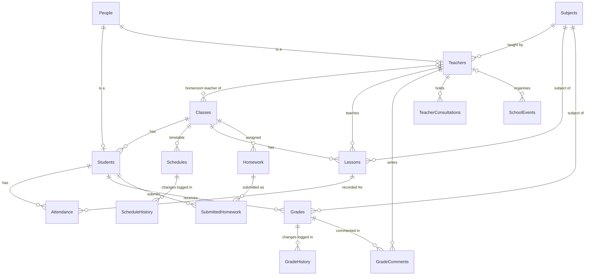

# School Database System

**SQL Server (T-SQL) · Python · Tkinter · pyodbc**

A relational database for running a school: students, teachers, classes, weekly timetables, lessons, attendance, grades, homework, consultations and school events. The database is built in SQL Server with T-SQL (tables and constraints, views, functions, stored procedures, triggers, backup and restore), and a small Python desktop app lets you manage people records.

All scripts run without errors on a fresh SQL Server database, and the included test script checks the business rules (11 of 11 tests pass).

## Highlights

- **16 related tables** with primary and foreign keys, `CHECK`, `UNIQUE` and `NOT NULL` constraints, and indexes on the columns used in joins.
- **Inheritance (Table-per-Type):** `People` is the shared table for everyone; `Students` and `Teachers` hold role-specific data. A composite foreign key guarantees that a teacher cannot be enrolled as a student (and the other way round).
- **9 reporting views**, **3 scalar functions** and **6 stored procedures**, including `AddStudent`, which creates the person and the enrolment in one transaction with `TRY…CATCH`.
- **7 triggers**:
  - validation: grade must be 1–6; homework due date cannot be in the past;
  - conflict detection: a class or a teacher cannot have two lessons at the same time;
  - audit history: every change of a grade or timetable slot is logged automatically;
  - lesson cancellation: attendance is marked `Cancelled`;
  - clean-up: deleting a student also removes their grades, comments, attendance and homework.
- **Reporting queries:** ranking with window functions, attendance rate per student, average grade per class and subject, students at risk, homework submission rate.
- **Backup strategy:** nightly full backup, differential backup every 6 hours, backup verification and a restore procedure.
- **Python GUI:** browse, add, edit and delete people, with input validation and clear error messages. The connection settings come from environment variables, so no server names or passwords are stored in the code.

## Database schema



## Repository structure

```
├── README.md
├── DOCUMENTATION.md            full description of the database with all the code
├── sql/
│   ├── 00_create_database.sql
│   ├── 01_tables.sql           16 tables, constraints, indexes
│   ├── 02_sample_data.sql      sample school: 2 classes, 6 students, 3 teachers
│   ├── 03_views.sql            9 views
│   ├── 04_functions.sql        3 functions
│   ├── 05_procedures.sql       6 stored procedures
│   ├── 06_triggers.sql         7 triggers
│   ├── 07_backup_restore.sql   backup, verification, restore
│   ├── 08_example_queries.sql  10 example and reporting queries
│   └── 09_tests.sql            11 automated checks (PASS / FAIL)
├── app/
│   └── school_gui.py           Tkinter desktop app for the People table
├── docs/
│   └── gui_screenshot.png
└── requirements.txt
```

## Getting started

### Requirements

- SQL Server 2017 or newer (the free Express or Developer edition is enough)
- SQL Server Management Studio (SSMS) or the `sqlcmd` command-line tool
- Python 3.10+ and the Microsoft **ODBC Driver 17 or 18 for SQL Server** (only for the GUI)

### 1. Create the database

Run the scripts `00` to `06` in order, either by opening them in SSMS and pressing **Execute**, or from PowerShell:

```powershell
cd sql
foreach ($f in "00_create_database", "01_tables", "02_sample_data", "03_views",
               "04_functions", "05_procedures", "06_triggers") {
    sqlcmd -S .\SQLEXPRESS -E -b -i "$f.sql"
}
```

### 2. Check that everything works

```powershell
sqlcmd -S .\SQLEXPRESS -E -i 09_tests.sql      # every test should print PASS
sqlcmd -S .\SQLEXPRESS -E -i 08_example_queries.sql
```

### 3. Run the desktop app

```powershell
pip install -r requirements.txt
python app/school_gui.py
```

By default the app connects to `localhost\SQLEXPRESS` with Windows authentication. To use another server or a SQL login, set these environment variables first: `SCHOOL_DB_SERVER`, `SCHOOL_DB_NAME`, `SCHOOL_DB_USER`, `SCHOOL_DB_PASSWORD`, `SCHOOL_DB_DRIVER`.


## Example: student ranking within each class

```sql
SELECT ClassName,
       FirstName + N' ' + LastName AS Student,
       CAST(AVG(GradeValue) AS DECIMAL(4,2)) AS AverageGrade,
       RANK() OVER (PARTITION BY ClassName ORDER BY AVG(GradeValue) DESC) AS RankInClass
FROM dbo.vw_Grades
GROUP BY ClassName, StudentID, FirstName, LastName
ORDER BY ClassName, RankInClass;
```

| ClassName | Student | AverageGrade | RankInClass |
|---|---|---|---|
| 1A | Jan Kowalski | 4.50 | 1 |
| 1A | Zofia Lewandowska | 4.33 | 2 |
| 1A | Michał Zieliński | 3.00 | 3 |
| 2A | Aleksandra Kamińska | 5.50 | 1 |
| 2A | Natalia Dąbrowska | 4.33 | 2 |
| 2A | Tomasz Szymański | 3.17 | 3 |

## Example: attendance rate per student

| Student | Lessons | Absences | LateArrivals | AttendanceRatePct |
|---|---|---|---|---|
| Michał Zieliński | 3 | 2 | 0 | 33.3 |
| Tomasz Szymański | 3 | 2 | 0 | 33.3 |
| Aleksandra Kamińska | 3 | 0 | 0 | 100.0 |
| Jan Kowalski | 3 | 0 | 0 | 100.0 |
| Natalia Dąbrowska | 3 | 0 | 1 | 100.0 |
| Zofia Lewandowska | 3 | 0 | 1 | 100.0 |

## Design decisions

- **Table-per-Type inheritance.** Common personal data lives in `People`; `Students` and `Teachers` add role-specific columns. Each subtype table has a persisted computed column (`'Student'` or `'Teacher'`) that is part of its foreign key to `People (PersonID, PersonType)`, so the database itself prevents a person from having the wrong role.
- **Cancelled lessons are kept, not deleted.** A lesson is cancelled with `IsCancelled = 1` (procedure `CancelLesson`), so the history stays complete and the attendance of that lesson is automatically set to `Cancelled`.
- **Automatic audit trail.** Triggers write the old and new values to `GradeHistory` and `ScheduleHistory`, so nobody has to remember to log a change.
- **Set-based triggers.** All triggers work on the `inserted` / `deleted` tables as sets, so they also behave correctly when many rows change at once.
- **Safe student deletion.** An `INSTEAD OF DELETE` trigger removes the dependent rows first, so foreign keys never block the delete and no orphaned data is left. The person's row in `People` is kept.

## Possible improvements

- Allow a teacher to teach several subjects (a `TeacherSubjects` junction table).
- Add database roles and permissions for teachers and administrators.
- Build a Power BI report on top of the views.
- Move the tests to the tSQLt unit-testing framework.

## Author

**Olha Rudenko** · [LinkedIn](https://www.linkedin.com/in/olha-rudenko-567060301)
